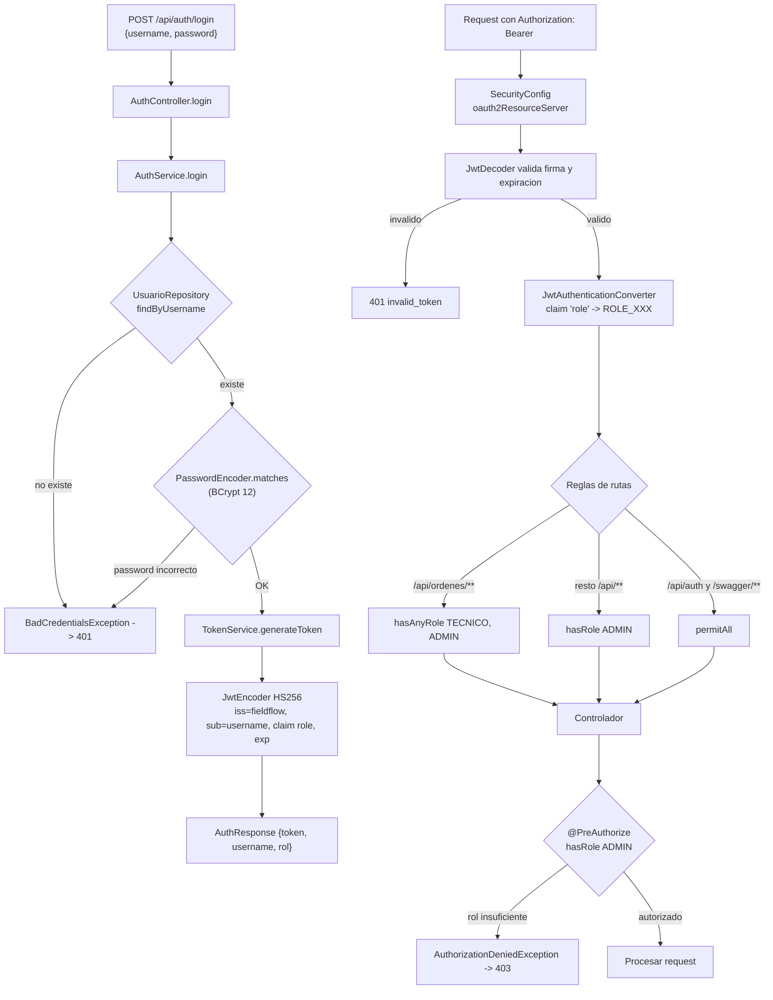
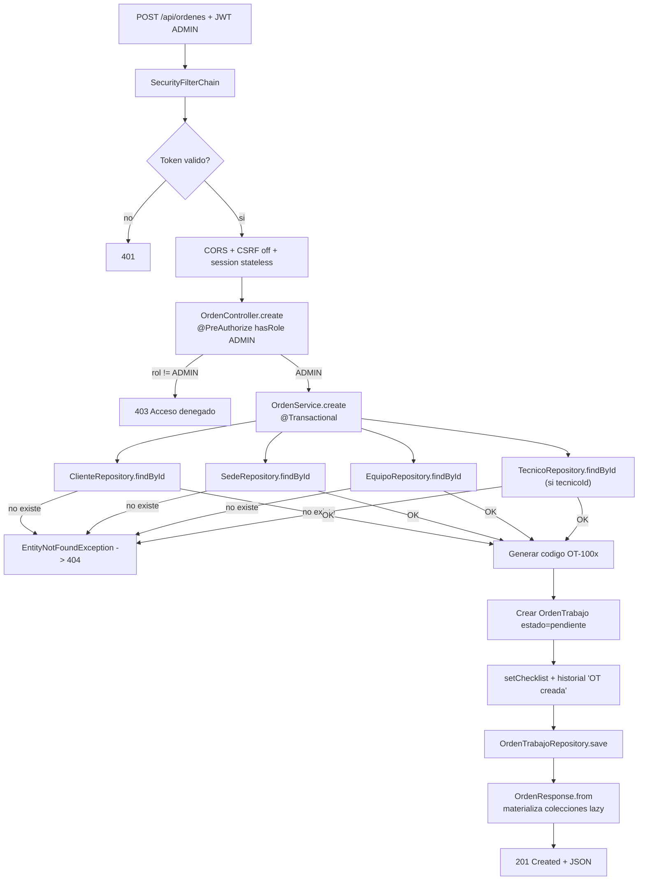
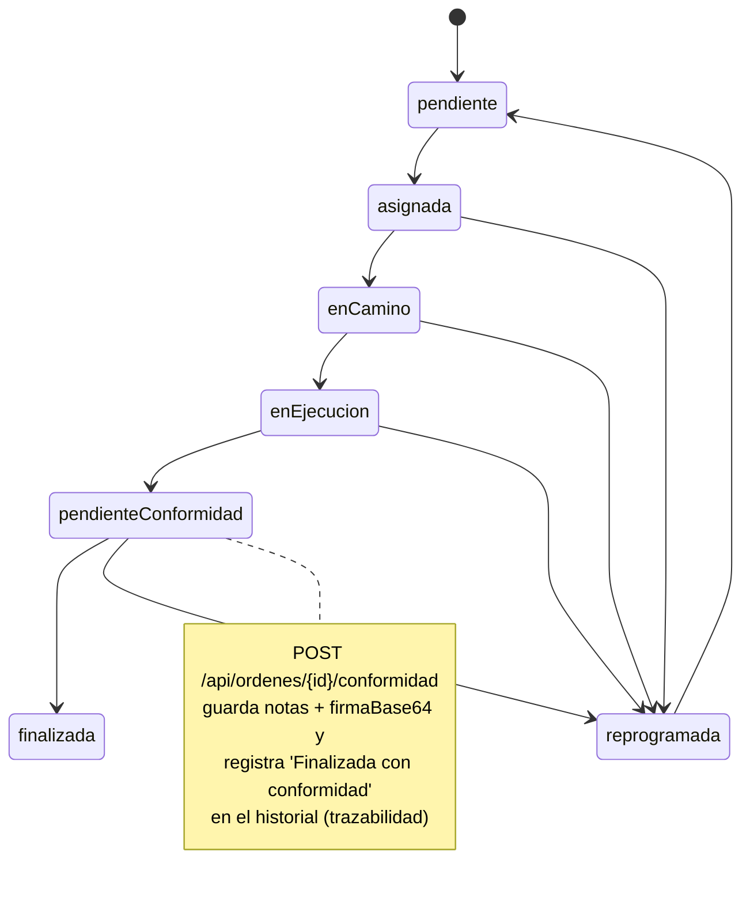
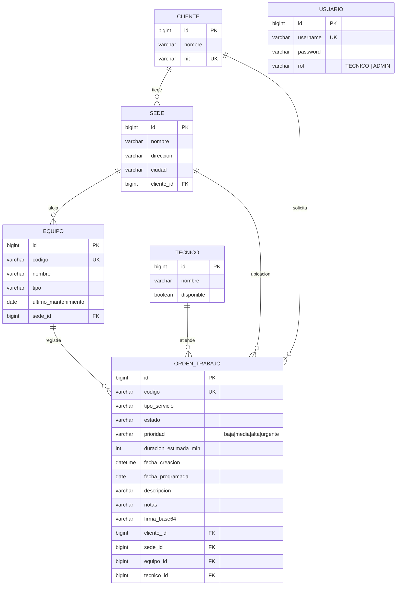
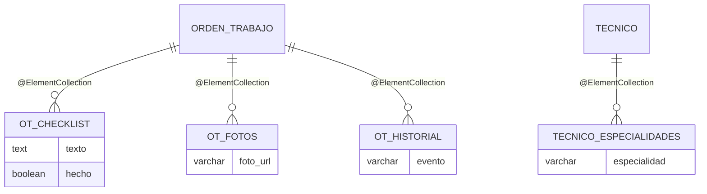

# FieldFlow Backend - Arquitectura

Backend REST para la gestion de servicios tecnicos en campo. Spring Boot 4.1.1, Spring Security 7 (JWT), Spring Data JPA, PostgreSQL/H2 y Swagger UI.

## 1. Vision general (capas)

```mermaid
flowchart TB
    subgraph Cliente["Cliente externo"]
        FE["Frontend React (PWA)"] --> API
        SW["Swagger UI / OpenAPI"] --> API
    end

    subgraph API["Backend FieldFlow  :8081"]
        direction TB
        SEC["SecurityConfig<br/>SecurityFilterChain + JWT"] --> CTRL

        subgraph CTRL["Controller (REST)"]
            A1["HomeController"]
            A2["AuthController<br/>/api/auth"]
            A3["CatalogoController<br/>/api/clientes|sedes|equipos|tecnicos|tecnicos/disponibles"]
            A4["OrdenController<br/>/api/ordenes<br/>+agenda/{tecnicoId}<br/>+preAuthorize ADMIN en create"]
        end

        CTRL --> SVC

        subgraph SVC["Service (logica de negocio)"]
            B1["AuthService"]
            B2["CatalogoService"]
            B3["OrdenService<br/>@Transactional"]
        end

        SVC --> REP

        subgraph REP["Repository (Spring Data JPA)"]
            C1["ClienteRepository"]
            C2["SedeRepository"]
            C3["EquipoRepository"]
            C4["TecnicoRepository"]
            C5["OrdenTrabajoRepository"]
            C6["UsuarioRepository"]
        end

        REP --> DB[("Base de datos<br/>PostgreSQL / H2")]
        SEC --> ERR["GlobalExceptionHandler<br/>401/403/400/404/500"]
        SVC --> ERR
    end
```

## 2. Autenticacion (login y emision de JWT)



## 3. Flujo de una peticion (crear orden de trabajo)



## 4. Ciclo de estados de la orden de trabajo



## 5. Modelo de datos (relaciones)



Colecciones embebidas de `OrdenTrabajo` (tablas hijas, no entidades):

