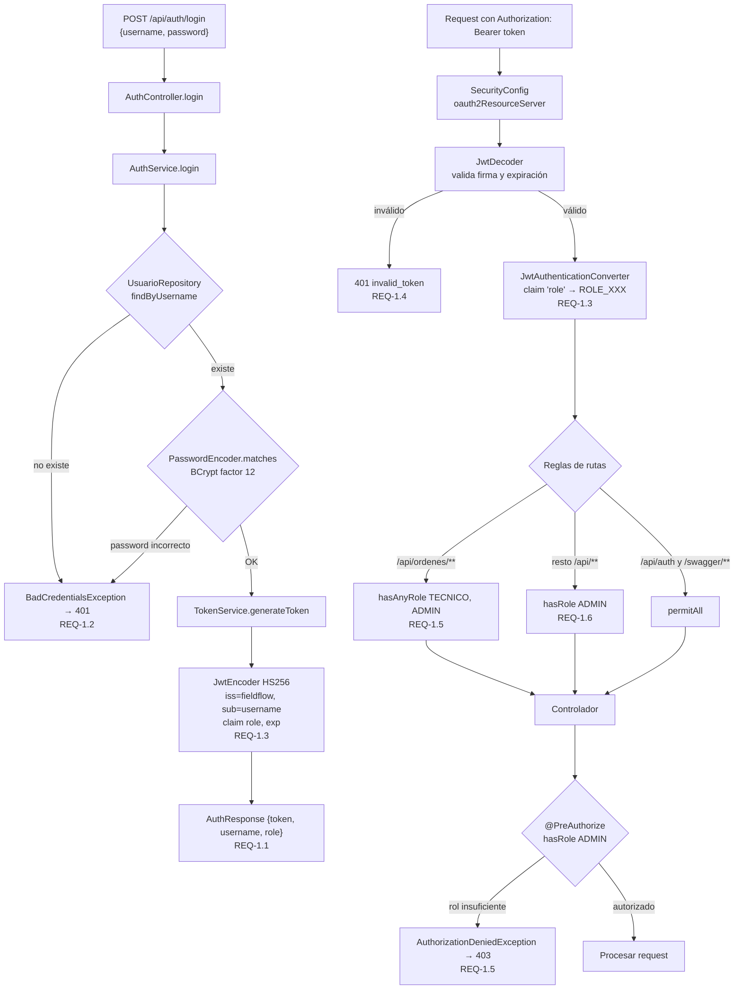
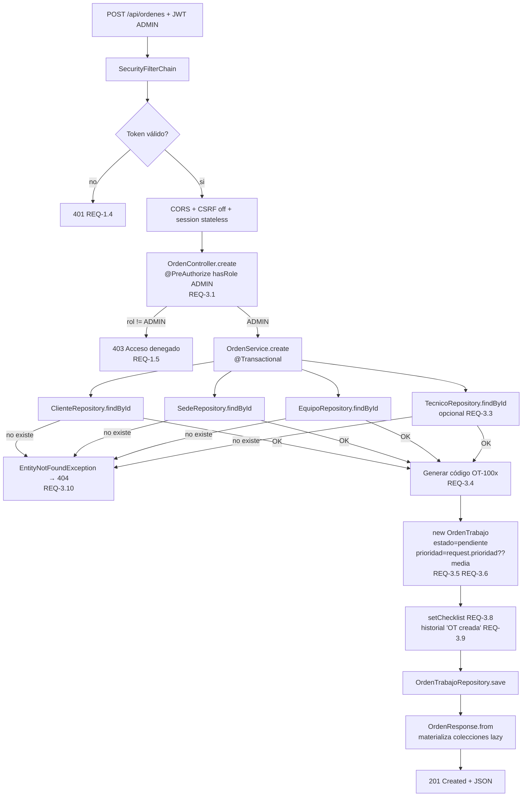
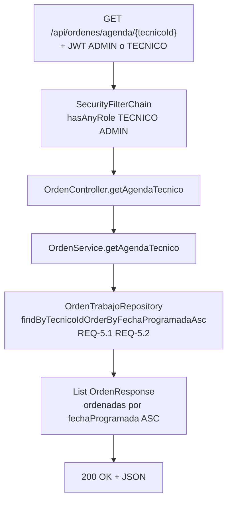
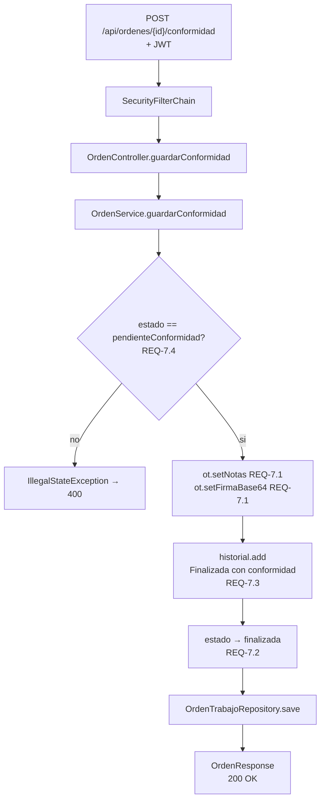
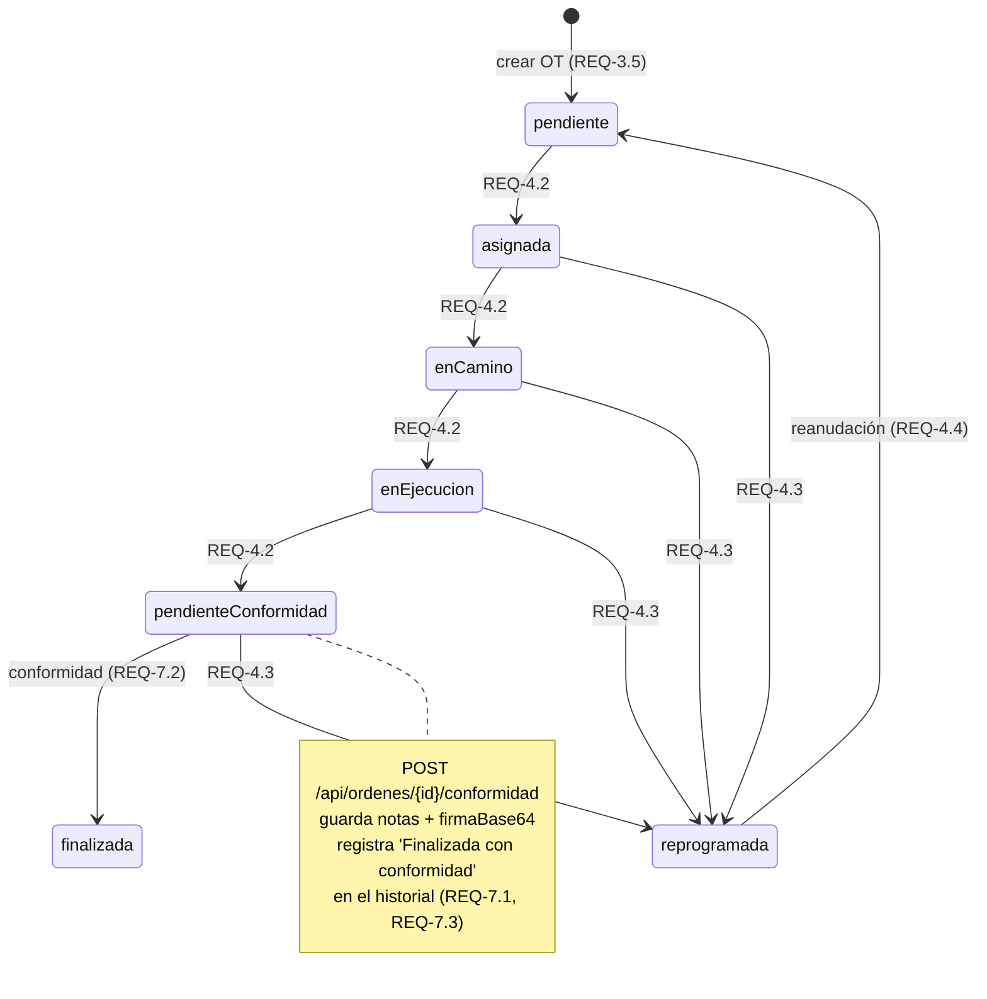
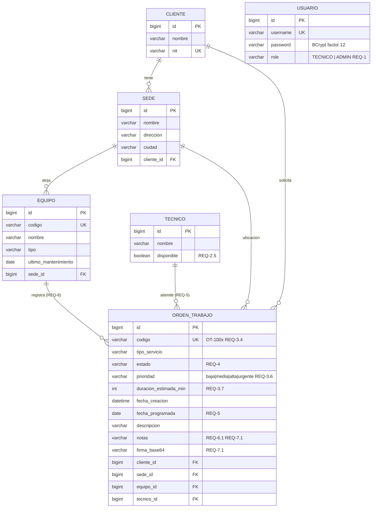
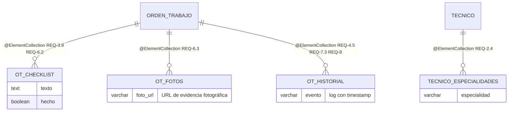

# FieldFlow Backend — Arquitectura

Backend REST para la gestión de servicios técnicos en campo. Spring Boot 4.1.1, Spring Security 7 (JWT HS256), Spring Data JPA, PostgreSQL/H2 y Swagger UI.

Requisitos cubiertos: REQ-1 · REQ-2 · REQ-3 · REQ-4 · REQ-5 · REQ-6 · REQ-7 · REQ-8

---

## 1. Visión general (capas)

```mermaid
flowchart TB
    subgraph Cliente["Cliente externo"]
        FE["Frontend React (PWA)"] --> API
        SW["Swagger UI / OpenAPI"] --> API
    end

    subgraph API["Backend FieldFlow  :8081"]
        direction TB
        SEC["SecurityConfig\nSecurityFilterChain + JWT\nREQ-1"] --> CTRL

        subgraph CTRL["Controller (REST)"]
            A1["HomeController"]
            A2["AuthController\n/api/auth\nREQ-1"]
            A3["CatalogoController\n/api/clientes|sedes|equipos\n/api/tecnicos|tecnicos/disponibles\nREQ-2"]
            A4["OrdenController\n/api/ordenes\n+agenda/{tecnicoId}\n+preAuthorize ADMIN en create\nREQ-3..REQ-8"]
        end

        CTRL --> SVC

        subgraph SVC["Service (lógica de negocio)"]
            B1["AuthService\nREQ-1"]
            B2["CatalogoService\nREQ-2"]
            B3["OrdenService\n@Transactional\nREQ-3..REQ-8"]
        end

        SVC --> REP

        subgraph REP["Repository (Spring Data JPA)"]
            C1["ClienteRepository"]
            C2["SedeRepository"]
            C3["EquipoRepository"]
            C4["TecnicoRepository\nfindByDisponibleTrue (REQ-2)"]
            C5["OrdenTrabajoRepository\nfindByEquipoId... (REQ-8)\nfindByTecnicoId... (REQ-5)"]
            C6["UsuarioRepository"]
        end

        REP --> DB[("Base de datos\nPostgreSQL / H2")]
        SEC --> ERR["GlobalExceptionHandler\n401/403/400/404/500"]
        SVC --> ERR
    end
```

---

## 2. Autenticación — login y emisión de JWT (REQ-1)



---

## 3. Flujo de una petición — crear Orden de Trabajo (REQ-3)



---

## 4. Flujo — Agenda del técnico (REQ-5)



---

## 5. Flujo — Conformidad del cliente (REQ-7)



---

## 6. Ciclo de estados de la Orden de Trabajo (REQ-4)



Cada transición registra un evento con timestamp en `ot_historial` (REQ-4.5).

---

## 7. Modelo de datos — relaciones (REQ-2, REQ-3, REQ-8)



---

## 8. Colecciones embebidas de OrdenTrabajo



---

## 9. Resumen de endpoints por requisito

| REQ | Endpoint | Método | Rol |
|---|---|---|---|
| REQ-1 | `/api/auth/login` | POST | público |
| REQ-1 | `/api/auth/register` | POST | público |
| REQ-2 | `/api/clientes` | GET | ADMIN |
| REQ-2 | `/api/sedes?clienteId=` | GET | ADMIN |
| REQ-2 | `/api/equipos?sedeId=` | GET | ADMIN |
| REQ-2 | `/api/tecnicos` | GET | ADMIN |
| REQ-2 | `/api/tecnicos/disponibles` | GET | ADMIN |
| REQ-3 | `/api/ordenes` | POST | ADMIN |
| REQ-4 | `/api/ordenes/{id}/estado` | PUT | ADMIN, TECNICO |
| REQ-5 | `/api/ordenes/agenda/{tecnicoId}` | GET | ADMIN, TECNICO |
| REQ-6, REQ-7 | `/api/ordenes/{id}/conformidad` | POST | ADMIN, TECNICO |
| REQ-8 | `/api/ordenes/{id}/trazabilidad` | GET | ADMIN, TECNICO |
| REQ-3..8 | `/api/ordenes` | GET | ADMIN, TECNICO |
| REQ-3..8 | `/api/ordenes/{id}` | GET | ADMIN, TECNICO |
